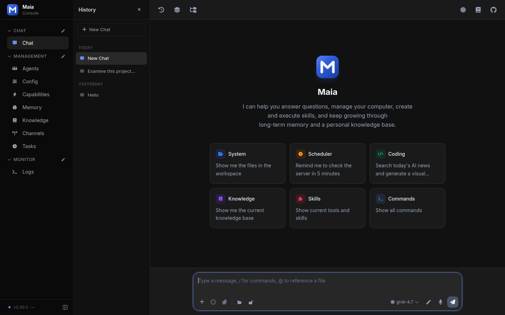

# Maia

Maia is a local agent. It is a fork of [CowAgent](https://github.com/zhayujie/CowAgent) (MIT). Copyright (c) 2022 zhayujie. © 2026 dubhagen.

Chat runs in the web console. The local terminal is also available. Every model call goes to one LiteLLM proxy that speaks the OpenAI HTTP API. The model id is whatever that proxy lists. Maia does not ship vendor SDKs, vendor API keys, or other chat channels.

Version 0.99.0. This is the public source release while patching is still in progress.



Source: https://github.com/dubhagen/Maia

## Run

```bash
git clone https://github.com/dubhagen/Maia.git
cd Maia
pip install -r requirements.txt
pip install -e .
maia start
```

`python app.py` from the checkout does the same thing. `run.sh` (Linux and macOS) and `scripts/run.ps1` (Windows) install dependencies and write `config.json`. They ask for the LiteLLM base, an optional key, and a model id.

The web console is http://127.0.0.1:9899/ after startup. With no `web_password`, the console does not ask you to sign in, and it listens on localhost. Config and logs live in `~/maia` when you installed the `maia` command, and in the checkout when you run `app.py` from a source tree.

Update a checkout with `git pull`. Maia does not look up GitHub releases or a desktop update feed.

## Configure

```json
{
  "channel_type": "web",
  "litellm_api_base": "http://127.0.0.1:4000/v1",
  "litellm_api_key": "",
  "model": "your-model-id",
  "embedding_model": "",
  "vision_model": "",
  "image_model": "",
  "asr_model": "",
  "tts_model": "",
  "tts_voice": "alloy",
  "agent_fallback_models": []
}
```

`litellm_api_base` must be an `http` or `https` URL ending in `/v1`. The key may be empty when the proxy does not require one. An empty model id for embeddings, vision, images, speech-to-text, or text-to-speech turns that capability off. `agent_fallback_models` is an ordered list of model ids on the same proxy.

The same values can be set in the web console under model settings. A new install starts the agent in `full-access` and leaves self-evolution on. Set `web_password` before you bind the console to anything other than localhost.

## What stays on your machine

- Web console and the terminal channel
- MCP servers you list in your own `mcp.json`
- The browser tool, which drives a local Chrome
- `web_fetch`, which requests the URL the agent asked for
- Web search only when you set `tools.web_search.searxng_url` to your SearXNG instance

Skills install from a git URL or a local path you type. A `skill_hub_url` is used only when you set one. There is no bundled skill marketplace.

## Docker

The image is `docker/Dockerfile.latest`. GitHub Actions does not publish it. The workflow `.github/workflows/deploy-image.yml` is manual, and it pushes to `ghcr.io` only when you run it after Actions and the container registry are enabled on the repository.

```bash
docker build -f docker/Dockerfile.latest -t maia:local .
docker compose -f docker/docker-compose.yml up
```

The compose file publishes port 9899 and points LiteLLM at `http://host.docker.internal:4000/v1` on the host. Set `WEB_PASSWORD` in that file before you expose the port.

## Docs

- [Introduction](docs/intro/index.mdx)
- [Models](docs/models/index.mdx)
- [Channels](docs/channels/index.mdx)
- [Web console](docs/channels/web.mdx)

`docs/releases/` is the upstream CowAgent changelog. The commit and pull-request links in those notes stay on `github.com/zhayujie/CowAgent`, because that is where those changes were made.

## License

MIT. See [LICENSE](LICENSE).
