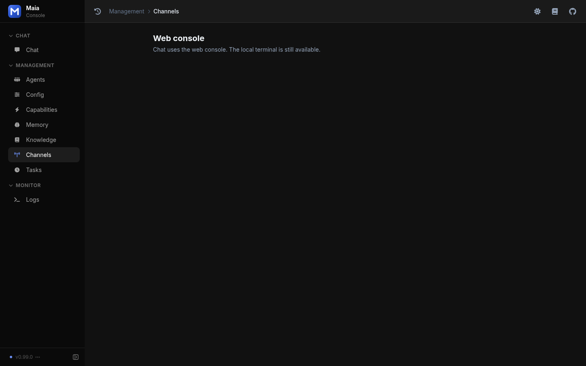

Maia has two chat surfaces:

| Channel | What it is |
| --- | --- |
| [Web console](/channels/web) | Browser chat and settings. This is the default. |
| Terminal | Local stdin and stdout. Set `channel_type` to `terminal` when you want that process instead of the web console. |

`channel_type` accepts `web` and `terminal`. Any other value is skipped at startup. WeChat, Feishu, DingTalk, WeCom, QQ, Telegram, Slack, and Discord are not included.

Management → Channels shows a single card for the web console and notes that the local terminal is still available.

<Frame caption="Channels page: web console only">
  
</Frame>

The web console still starts when `litellm_api_base` is missing, so you can open it and set the proxy. Model calls fail until the base is a valid `/v1` URL.
