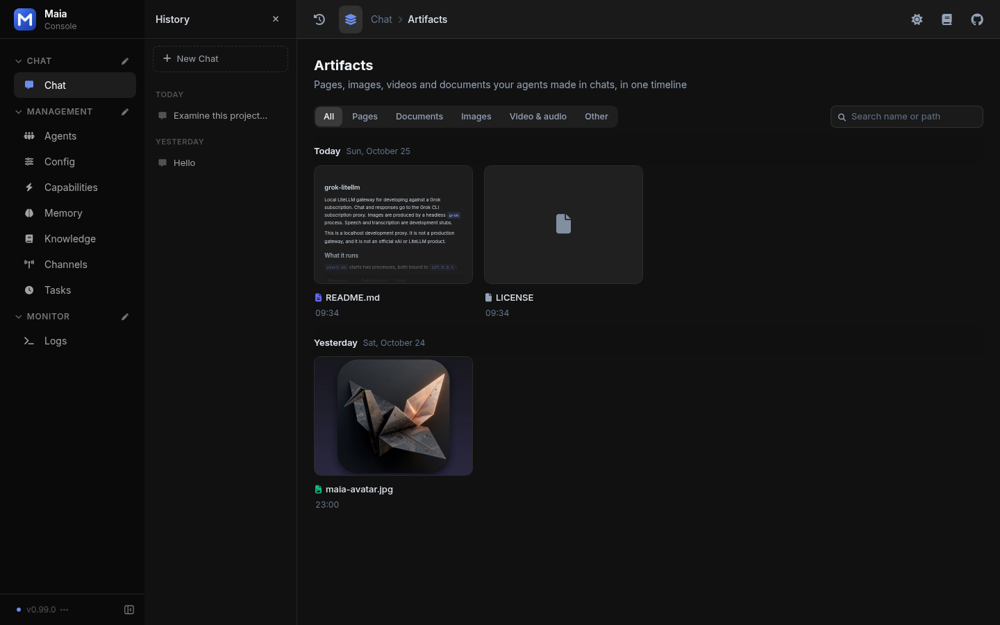
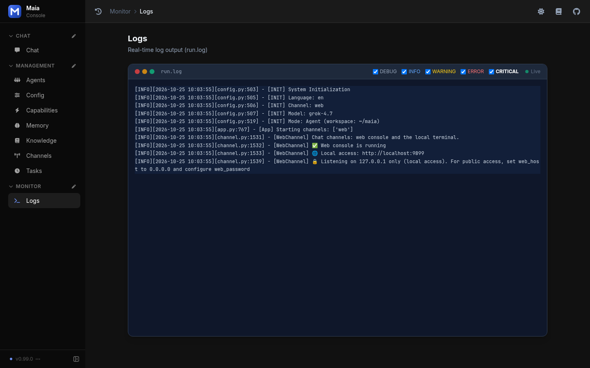

The web console chats with the agent and edits the LiteLLM endpoint, model ids, and local tools.

## Configuration

```json
{
  "channel_type": "web",
  "web_host": "",
  "web_port": 9899,
  "web_password": "",
  "litellm_api_base": "http://127.0.0.1:4000/v1",
  "litellm_api_key": "",
  "model": ""
}
```

| Parameter | Description | Default |
| --- | --- | --- |
| `channel_type` | `web` for this console | `web` |
| `web_host` | Bind address. Empty follows the process default. | `""` |
| `web_port` | Listen port | `9899` |
| `web_password` | Login password. Set one before you bind a non-local address. | `""` |
| `litellm_api_base` | LiteLLM proxy, `http` or `https`, ending in `/v1` | `""` |
| `litellm_api_key` | Optional bearer token for that proxy | `""` |
| `model` | Chat model id from the proxy | `""` |

After startup, open `http://localhost:9899/`. A new chat opens on the welcome screen: the Maia mark, six prompt chips, and a composer. The composer shows the current model. The sidebar is Chat, Management, and Monitor.

<Frame caption="Web console welcome screen on a new chat">
  
</Frame>

Chat → Artifacts collects pages, images, and documents the agent produced. Filter by kind, or search by name.

<Frame caption="Artifacts timeline: two documents and one generated image">
  
</Frame>

Monitor → Logs tails `run.log`. Startup lines name the language, the model, the channel, and the listen address.

<Frame caption="Logs view of run.log after startup">
  
</Frame>

The models page is one LiteLLM card: base URL, optional key, and the models the proxy lists. The channels page only describes this console.
