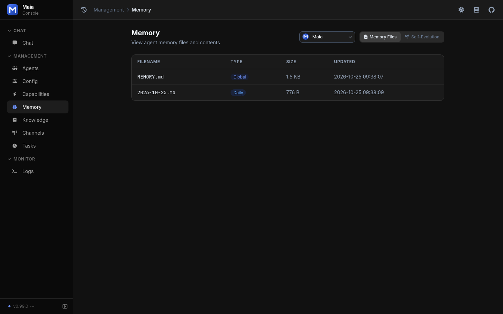
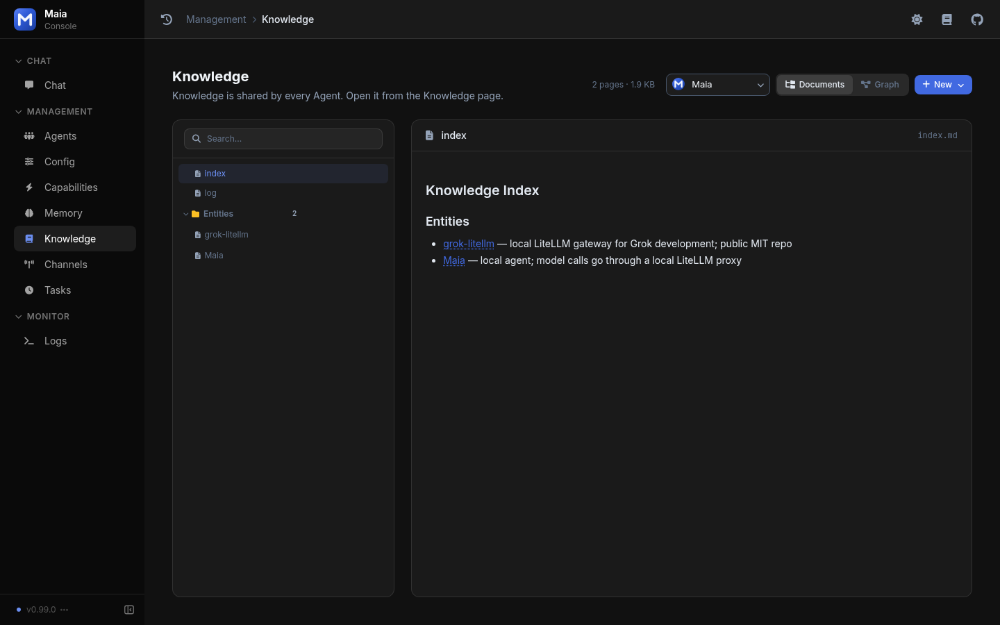
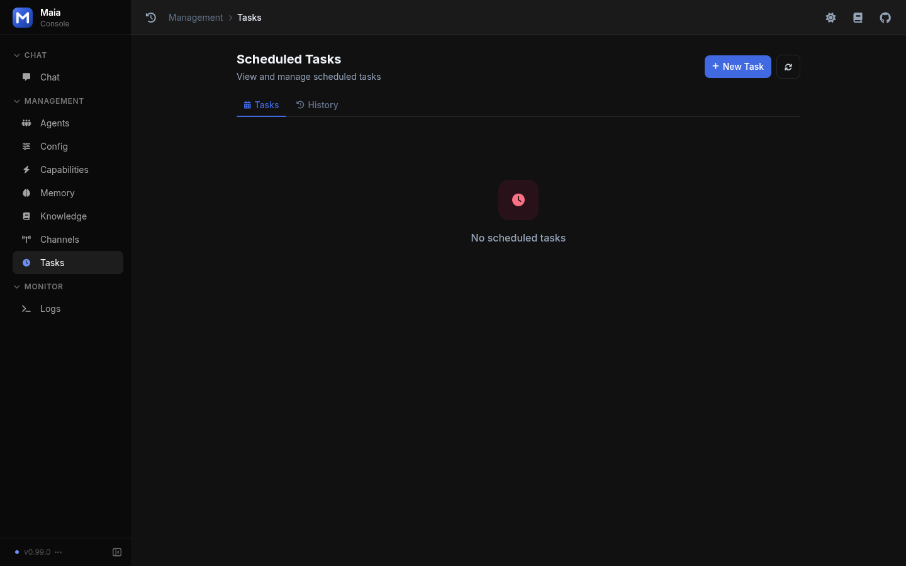
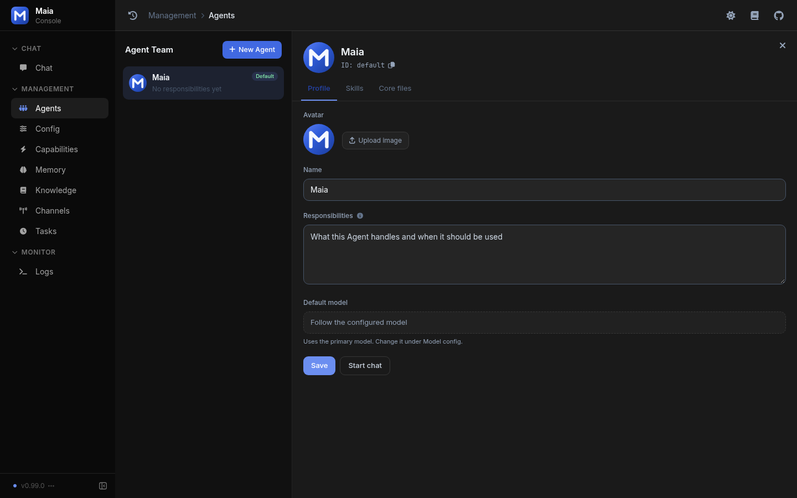

# Features

## 1. Long-term Memory

The memory system enables the Agent to remember important information over time, using a three-tier memory flow: conversation context (short-term) → daily memory (mid-term) → MEMORY.md (long-term), forming a complete memory lifecycle.

On first launch, the Agent proactively asks the user for key information and records it in the workspace (default `~/maia`) — including agent settings, user identity, and memory files.

In subsequent long-term conversations, the Agent intelligently stores or retrieves memory as needed, continuously updating its own settings, user preferences, and memory files. **Deep Dream** distillation runs daily, consolidating scattered daily memories into refined long-term memory and generating a narrative-style dream diary.



*Memory Files lists the global MEMORY.md and the day's daily file*

Building on this, **Self-Evolution** lets the Agent keep growing through everyday use: after a conversation goes idle, it reviews it automatically to improve skills, follow up on unfinished tasks, and backfill memory and knowledge. It speaks up only when it actually made a change, and every change can be undone. New installs leave it off. Records show up on the same Memory page, under Self-Evolution.

See [Long-term Memory](../memory/index.md), [Deep Dream](../memory/deep-dream.md), and [Self-Evolution](../memory/self-evolution.md) for details.

## 2. Personal Knowledge Base

> The knowledge base system enables the Agent to continuously accumulate and organize structured knowledge. Unlike memory which records along a timeline, the knowledge base is organized by topics, transforming articles, conversation insights, and learning materials into interconnected Markdown pages that form a continuously growing knowledge network.

The Agent organizes useful conversation material into knowledge pages, with an index and cross-references. Knowledge is stored in `~/maia/knowledge/`. In the console, Management → Knowledge opens on Documents: a page tree on the left and the selected page on the right. Graph is the other view on that page.

- **Auto-organization**: The Agent autonomously extracts and organizes structured knowledge during conversations, maintaining indexes and cross-references
- **Knowledge graph**: Automatically builds a knowledge graph from cross-references between pages, with interactive graph visualization in the Web console
- **Chat integration**: Knowledge document links referenced in Agent replies can be clicked directly in the Web console for viewing
- **CLI management**: Use `/knowledge` commands to view stats, browse directory, and toggle the feature with `/knowledge on|off`



*Knowledge Documents: the page tree and the open index*

See [Personal Knowledge Base](../knowledge/index.md) for details.

## 3. Task Planning and Tool Use

Tools are the core of how the Agent accesses operating system resources. The Agent intelligently selects and invokes tools based on task requirements, performing file read/write, command execution, scheduled tasks, and more. Built-in tools are implemented in the project's `agent/tools/` directory.

**Key tools:** file read/write/edit, Bash terminal, browser, file send, scheduler, memory search, web search, environment config, and more.

### 3.1 Terminal and File Access

Access to the OS terminal and file system is the most fundamental capability. Many other tools and skills build on top of it. From the web console you can ask the agent to operate files and commands on the machine where Maia is running.

### 3.2 Programming Capability

Combining programming and system access, the Agent can run a full coding workflow — search, generate assets, write code, test, and deploy — from one request in the web console.

### 3.3 Scheduled Tasks

The `scheduler` tool creates one-time tasks, fixed intervals, and cron tasks. A task can send a fixed message or run an agent turn. Management → Tasks is where those tasks are listed. A new install starts with an empty list and a New Task button.



*Tasks page before any task has been added*

### 3.4 Browser

The built-in `browser` tool lets the Agent drive a Chromium browser: open pages, fill forms, click, and take screenshots, including pages that render with JavaScript. Run `maia install-browser` once. It adapts to a headless server and a desktop.

### 3.5 Environment Variable Management

Secrets a skill needs live in the workspace environment file. The `env_config` tool reads and updates them from chat, and masks values when it lists them. That file is separate from the LiteLLM key on the Config page.

## 4. Skills System

The Skills system provides infinite extensibility for the Agent. Each Skill consists of a description file, execution scripts (optional), and resources (optional), describing how to complete specific types of tasks. Skills allow the Agent to follow instructions for complex workflows, invoke tools, or integrate third-party systems.

- **Built-in skills:** Located in the project's `skills/` directory. A skill runs when its dependencies are present.
- **Custom skills:** Created by users through conversation, stored in the workspace (`~/maia/skills/`).

Install a skill from a git URL or a local path: `/skill install <url>` or `maia skill install <url>`. There is no skill marketplace.

### 4.1 Creating Skills

The `skill-creator` skill turns a workflow or an API note into a skill through conversation. Management → Capabilities is where you see the result: built-in tools, MCP servers, and workspace skills, each skill with its own switch.


*Capabilities: built-in tools, an empty MCP section, and three skills switched on*

### 4.2 Web Search and Image Recognition

- **Web search:** Built-in `web_search` tool. It queries SearXNG only when `tools.web_search.searxng_url` is set.
- **Image recognition:** Uses `vision_model` on the same LiteLLM endpoint. An empty id uses the chat model when that model accepts images.

### 4.3 Installing a skill

```text
/skill install <git-url>
/skill install <owner>/<repo>
```

See [Install Skills](../skills/install.md).

## 5. CLI Command System

Maia provides two command interaction methods, covering service management, skill installation, configuration, and more:

- **Terminal CLI:** Run `maia <command>` in the system terminal, supporting `start`, `stop`, `restart`, `update`, `status`, `logs`, `skill`, etc.
- **Chat commands:** Type `/<command>` in conversation. The Web console shows a command menu when you type `/`.

```bash
maia start              # Start service
maia stop               # Stop service
maia update             # Update and restart
maia skill install pptx # Install a skill
maia install-browser    # Install browser tool
```

See [Command Overview](../cli/general.md) for details.

## 6. Multi-Agent Teams

Maia can run more than one Agent. Each member has its own responsibilities, model, skills, knowledge, workspace, and memory. Management → Agents opens the team list and the selected member's profile: name, responsibilities, avatar, and default model.



*Agent Team with the default Maia profile open*

In a group-chat session, several Agents can take part. Use `@` to direct a member, or let the lead Agent **delegate** a task and fold the result into one reply. The lead Agent can also start temporary **sub-Agents** for side work, returning only the conclusion.

See [Agent Teams](../multi-agent/team.md), [Task Delegation](../tools/delegate.md), and [Sub-Agents](../multi-agent/subagent.md) for details.
