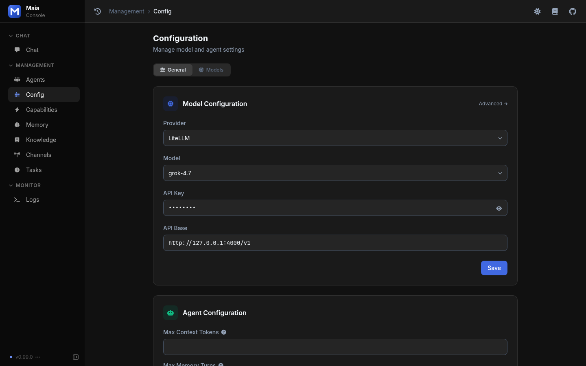
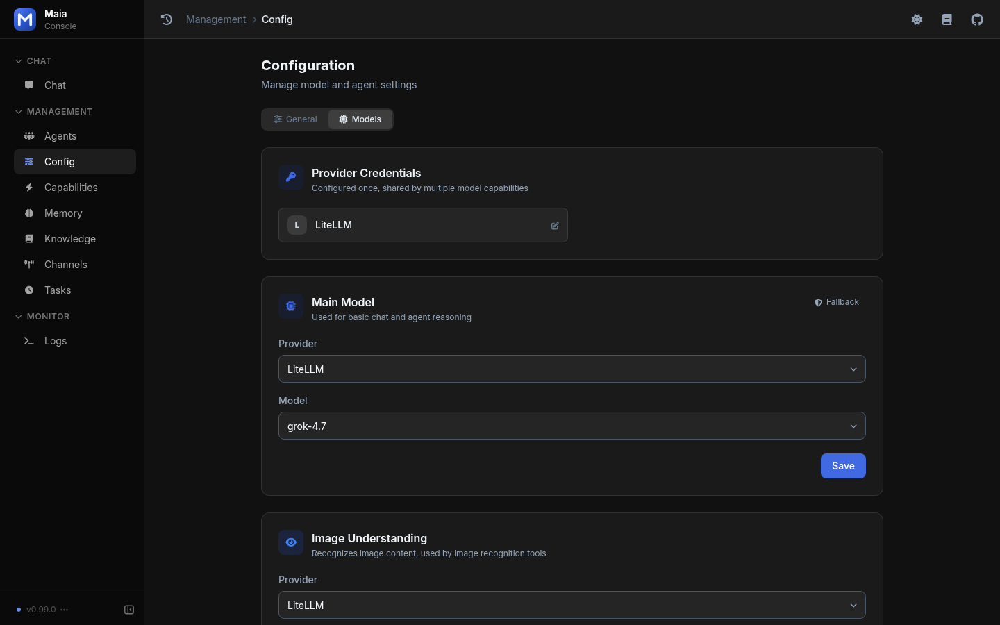

# Models

Maia sends chat, vision, embeddings, images, speech-to-text, and text-to-speech to one LiteLLM proxy. The model id is the id the proxy returns. Maia does not rewrite it and does not keep a separate key per vendor.

Management → Config has two tabs. General sets the provider, the chat model, the API key, and the API base. Agent Configuration continues on the same tab, starting with max context tokens. Models is where that one endpoint is shared by the other capabilities.



*Config → General: LiteLLM provider, chat model, key, and API base*



*Config → Models: one LiteLLM credential, the main model, and image understanding*

## Configuration

```json
{
  "litellm_api_base": "http://127.0.0.1:4000/v1",
  "litellm_api_key": "",
  "model": "your-chat-model",
  "embedding_model": "",
  "vision_model": "",
  "image_model": "",
  "asr_model": "",
  "tts_model": "",
  "tts_voice": "alloy",
  "agent_fallback_models": []
}
```

| Field | Call | When it is empty |
| --- | --- | --- |
| `model` | `POST {base}/chat/completions` | Chat replies fail until you set a model id |
| `agent_fallback_models` | Same endpoint, next id in the list | No fallback |
| `vision_model` | Chat completions with an image part | Uses the chat model when that model accepts images |
| `embedding_model` | `POST {base}/embeddings` | Memory stays keyword-only |
| `image_model` | `POST {base}/images/generations` | Image generation is off |
| `asr_model` | `POST {base}/audio/transcriptions` | Speech-to-text is off |
| `tts_model` | `POST {base}/audio/speech` | Text-to-speech is off |

`litellm_api_base` must be an `http` or `https` URL and must end with `/v1`. A missing or malformed base fails that model call. The web console can still start so you can fill the value in. `litellm_api_key` may be empty. Old vendor keys in a previous `config.json` are not read for these calls.

## Discovery

The models screen probes:

1. `GET {litellm_api_base}/models`
2. `GET {origin}/model/info` when the proxy exposes it

`model_info.mode` maps onto catalog tags: `chat` to text, `supports_vision` to vision, `embedding`, `image_generation` to image, `audio_transcription` to speech-to-text, and `audio_speech` to text-to-speech. A model with no metadata is tagged text. The overlay in `models/model_catalog.py` (`~/maia/system/models.json`) still wins for tags and context windows you set by hand.

Optional `reasoning_effort` (`low`, `medium`, `high`, `xhigh`, `max`) is forwarded only when thinking is enabled. There is no per-vendor request body.

## Fallback

`agent_fallback_models` is a list of model ids on this same proxy. It is not a list of providers.
