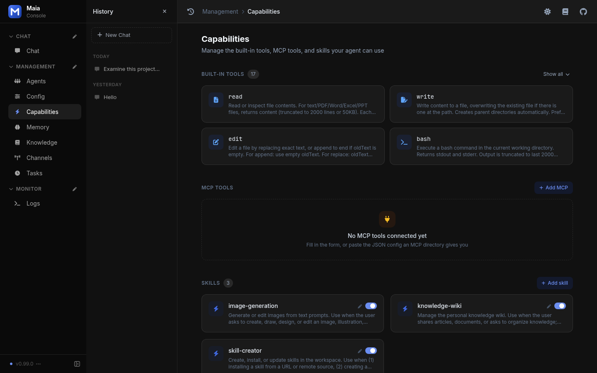

Maia supports the [Model Context Protocol (MCP)](https://modelcontextprotocol.io), allowing the Agent to directly invoke tens of thousands of community MCP tools. Configure `mcp.json` once and the tools are exposed to the LLM in exactly the same way as built-in tools — automatically selected and invoked.

## Web and Desktop Console

The **MCP Tools** section of the Capabilities page in the **web console** and **desktop app** can add, edit, disable, and remove MCP servers without editing `mcp.json` by hand.

- **Form or JSON**: fill in the form, or paste a standard `mcpServers` config in JSON mode (several servers at once), for example `{"mcpServers":{"fetch":{"command":"uvx","args":["mcp-server-fetch"]}}}`.
- **Test connection**: checks that each server is reachable and lists its tools. Saving runs the same check first; if it fails, fix the config or choose **Save anyway** (for servers that require authorization after saving).
- **Storage**: written to the current Agent's `mcp.json`, in the same format as Claude Desktop / Cursor.
- **Immediate effect**: changes apply from the next message, with no restart.

stdio, SSE, and streamable HTTP transports are all supported. A disabled server stays in the file but is not booted.

On Capabilities, MCP Tools sits under the built-in tools. With no `mcp.json` servers, that block is empty and offers Add MCP. The skills on the same page are separate.

<Frame caption="Capabilities with no MCP server connected yet">
  
</Frame>

## Configuration File

Maia reads `~/maia/mcp.json`. If the file does not exist, no MCP tools are loaded — and no error is raised.

For Docker deployments, the official `docker-compose.yml` already mounts the host's `./maia` directory to `/home/agent/maia` inside the container (i.e. the container user's `~/maia`). Just drop `mcp.json` into the host's `./maia/` directory and it will take effect.

### Standard Format

Fully compatible with the MCP community standard, identical to Claude Desktop / Cursor:

```json
{
  "mcpServers": {
    "<server-name>": {
      "command": "npx",
      "args": ["-y", "some-mcp-package"],
      "env": {
        "API_KEY": "your-key-here"
      }
    }
  }
}
```

| Field | Required | Description |
| --- | --- | --- |
| `command` | stdio | Executable to launch the server (e.g. `npx`, `python`, `uvx`) |
| `args` | No | Arguments passed to `command` |
| `env` | No | Environment variables for the subprocess, commonly used for API keys |
| `url` | SSE / Streamable HTTP | Remote endpoint URL (alternative to `command`) |
| `type` | Remote | Remote transport type: `sse` or `streamable-http` (defaults to `sse`) |
| `headers` | No | Extra HTTP headers for remote requests (e.g. `Authorization`); Streamable HTTP only |
| `scope` | No | OAuth scope, only for remote servers that require OAuth authorization (optional) |
| `tool_name_prefix` | No | String prepended to this server's tool names in Maia, e.g. `myserver_`. Defaults to an empty string. Include any separator in the prefix. Use a unique prefix to avoid collisions with built-in tools or other servers. |
| `disabled` | No | When `true`, this server is skipped — handy for temporary disabling |

### Full Example

```json
{
  "mcpServers": {
    "fetch": {
      "command": "uvx",
      "args": ["mcp-server-fetch"]
    },
    "github": {
      "command": "npx",
      "args": ["-y", "@modelcontextprotocol/server-github"],
      "env": {
        "GITHUB_PERSONAL_ACCESS_TOKEN": "<YOUR_TOKEN>"
      }
    }
  }
}
```

- **fetch**: Generic web page fetcher that returns page text content. No API key required.
- **github**: Access GitHub repos, issues, PRs, etc. Requires a Personal Access Token.

### Streamable HTTP with a Bearer Key

For a remote server that authenticates with a static API key, set `type` explicitly — a remote URL without it falls back to `sse` — and pass the key in `headers`:

```json
{
  "mcpServers": {
    "my-remote-tools": {
      "type": "streamable-http",
      "url": "https://mcp.example.com/mcp",
      "headers": {
        "Authorization": "Bearer YOUR_API_KEY"
      }
    }
  }
}
```

- Header values are sent literally: `${API_KEY}` is **not** expanded from the environment.
- The key is stored as plain text, so keep `mcp.json` out of version control.
- An `Authorization` header selects static authentication and skips the OAuth flow below, even when the value is wrong.

## Let the Agent Configure It for You

Maia ships with `read` / `write` / `edit` tools, so **you can simply send the MCP config to the Agent and ask it to write the file**:

For example:

```markdown
Add this MCP to ~/maia/mcp.json:

{"mcpServers":{"fetch":{"command":"uvx","args":["mcp-server-fetch"]}}}
```

The Agent will:

1. Read the existing MCP config and merge the new server entry, preserving existing ones
2. Hot-reload the new MCP server, so the corresponding tools become available on the next message

<Note>
Commands in `mcp.json` start with the Agent process's privileges, so the Agent may only change `mcp.json` in a **full-access** session. Read-only and workspace-write sessions refuse it: switch the session's permission, or add the server from the console.
</Note>

## Web Authorization (OAuth)

Some remote MCP servers require OAuth web authorization, and connecting to them directly returns `401`. Maia has a built-in standard OAuth flow, so **no manual token is needed** — just configure the server normally, for example:

```json
{
  "mcpServers": {
    "xmind": {
      "type": "streamable-http",
      "url": "https://app.xmind.com/api/mcp"
    }
  }
}
```

When a server returns `401` on its first load, authorization starts automatically: running locally **opens the browser automatically**, while server deployments **print the authorization link to the log** for you to open in a browser. Once you approve, the server comes online immediately; tokens are refreshed automatically on expiry, so you never have to re-authorize.

- **Requires the web service**: The authorization callback is received by the web console (default port `9899`), so the Web channel must be running.
- **Credential storage**: Tokens are persisted in `~/.maia/mcp_oauth.json` and reused across restarts.
- **Callback URL**: Defaults to `http://127.0.0.1:9899/mcp/oauth/callback`. If deployed on a server with the authorizing browser on another device, set `mcp_oauth_redirect_base` in `config.json` (e.g. `http://YOUR_IP:9899`).

## How It Works

- **Async loading at startup**: All servers configured in `mcp.json` are loaded asynchronously in the background, never blocking the main loop — chat is usable immediately.
- **Hot reload**: When you or the Agent modifies `mcp.json`, changed servers are automatically reloaded after the current message — no need to restart maia.
- **Flat exposure**: Each method exposed by an MCP server appears as an individual tool. The LLM picks one directly without a second-stage decision.

## Supported Transports

| Transport | Description | Config Field |
| --- | --- | --- |
| **stdio** | Subprocess communication. The most common option, with the richest community ecosystem. | `command` + `args` |
| **SSE** | HTTP Server-Sent Events. Legacy remote transport. | `url` (default) |
| **Streamable HTTP** | New unified remote transport, gradually replacing SSE. | `type: "streamable-http"` + `url` |

## Troubleshooting

| Symptom | What to Check |
| --- | --- |
| Agent has no MCP tools after startup | Verify that `~/maia/mcp.json` exists and contains valid JSON |
| A specific server fails to load | Look for `[MCP] Server 'xxx' load failed` in startup logs — usually missing dependencies or API keys |
| Changes to `mcp.json` aren't applied | Changes take effect on **the next message**. If the server config didn't actually change (e.g. only comments edited), no restart is triggered |
| Docker deployment | Make sure host's `./maia` is mounted to `/home/agent/maia` in the container, then just drop `mcp.json` into host's `./maia/`. Or just ask the Agent to do it |

Add servers yourself in `mcp.json`. Any MCP server that follows the standard protocol (stdio / SSE / Streamable HTTP) integrates with Maia. Maia does not call an MCP marketplace.
